# MochiMate

<p align="center">
  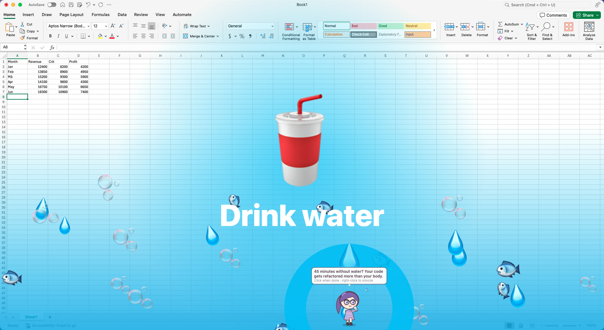
</p>

**A tiny anime coworker for your Mac.** MochiMate puts a chibi character on your Desktop who reminds you to drink water, stand up and rest your eyes. When one is due the character runs over to you, the whole screen takes over with an effect, and a line in your language is shown and spoken. It is much harder to swipe away than a notification banner, and funnier.

<p align="center">
  <a href="https://mochimate.khuongdv.link/demo-excel-raw.mp4">
    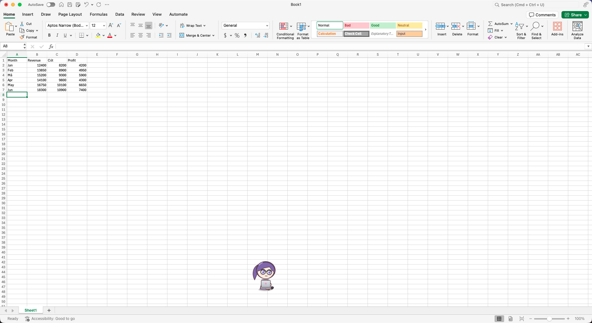<br>
    <b>▶ Watch it on screen</b>
  </a><br>
  <sub>A raw, unedited screen recording of the real app over an open Excel sheet (105 s, no sound).</sub>
</p>

The app lives in the menu bar only (a mochi-face icon); it has no Dock icon.

## What it looks like

A reminder takes over the screen, in one of three looks per kind (this is the real app on top of Excel):

| Drink water | Stand up and move | Rest your eyes |
| :---: | :---: | :---: |
|  | 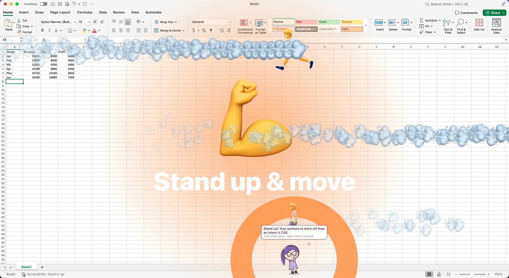 | 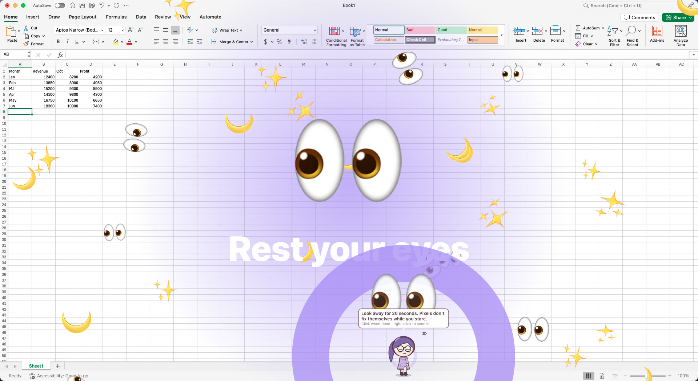 |

Between reminders the character just lives on your Desktop, and now and then casts one of its two skills:

| On the Desktop | Code Rain (Rin) | Refactor Beam (Rin) |
| :---: | :---: | :---: |
|  | 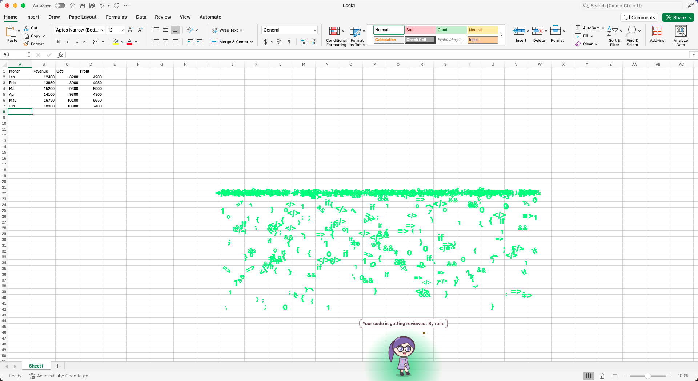 | 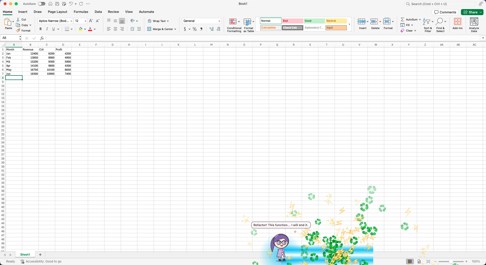 |

Everything is set in the menu and in Settings (here in English; Vietnamese and Japanese are built in):

| Menu bar | Characters | Reminders | Schedule | Behavior |
| :---: | :---: | :---: | :---: | :---: |
| 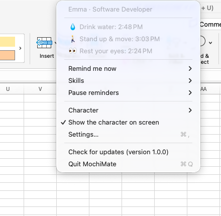 | 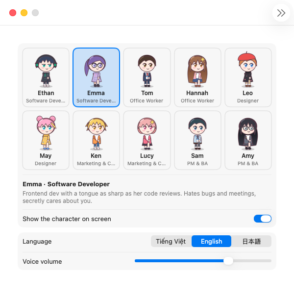 | 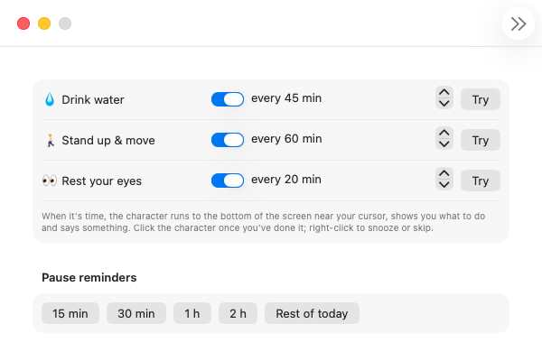 | 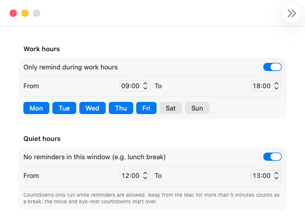 | 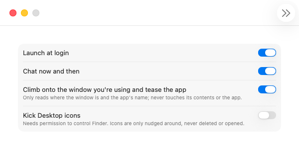 |

## Features

- **10 characters, 5 professions, one man and one woman each**, each with its own look, personality and lines:
  - Names are localized: e.g. Kai is Khải (vi), Ethan (en), カイ (ja); the ids stay `kai`, `rin`, …
  - Software Developer: Kai, Rin
  - Office Worker: Taro, Hana
  - Designer: Leo, Mei
  - Marketing & Content Creator: Ken, Yui
  - Project Manager & Business Analyst: Sora, Aki
- **Health reminders:** water (every 45 min), move (60 min), eye rest (20 min, the 20-20-20 rule) by default, each with its own interval. When one is due the character runs to the bottom of the screen near your cursor, the screen fills with a full-screen effect (three looks per reminder, picked at random), the character acts it out (drinks, stretches, does eye exercises) and says a line. Click the character when you've done it; right-click to snooze 10/30 minutes or skip.
- **Spoken reminders:** most reminder lines have pre-recorded voices in English, Japanese and Vietnamese (a male and a female voice each), played at the volume set in Settings.
- **Lives on the Desktop:** walks and runs around, across every screen; works on a laptop, gets bored, yawns, falls asleep, and complains now and then about work and life. Click it, drag it, poke it too often and it gets grumpy.
- **2 skills per character (20 in all):** effects around the character (rocket launch, code rain, payday rain, approval stamp, aurora, radar…) with a line of dialogue. Cast now and then on their own, or from the **Skills** submenu in the menu bar and the right-click menu.
- **Plays around (opt-in):** perches on top of the window you're using and teases the app by name, and kicks Desktop icons around (needs permission to control Finder; off by default).
- **Schedule:** reminders only during work hours (days and times), none during quiet hours (lunch break by default), and a pause for 15 min to the rest of the day. Countdowns stand still outside those times, and being away from the Mac for 5+ minutes counts as a break.
- **Launch at login:** one switch in Settings.
- **Lines that don't repeat:** recently said lines are skipped until the rest have been used, across launches.
- **3 languages:** Vietnamese, English and Japanese, for the settings, menus and dialogue.
- **Updates from GitHub Releases:** new app versions in one click, plus dialogue/audio packs that install automatically without an app release.

It stays light: one 30 fps timer, layer-based rendering, and reminders checked every 10 seconds. It never reads your data: the only things it looks at are where the frontmost window is and that app's name (for the window antics), and the Desktop icon positions (only with icon kicking on).

## Install

Requirements: macOS 13 or later.

1. Download `MochiMate-<version>.dmg` from [Releases](https://github.com/khdev3jk/MochiMate/releases/latest), open it and drag **MochiMate** into **Applications**.
2. The app is only ad-hoc signed (not notarized), so on first launch right-click it, choose **Open**, then **Open** again. If macOS says the app is damaged:
   ```sh
   xattr -dr com.apple.quarantine /Applications/MochiMate.app
   ```
3. To control Finder (only needed for the optional icon kicking), allow it when asked.

Or build it yourself (see [Build](#build)): `make run`, or `make dmg` for a disk image.

## Usage

Everything is in the menu-bar menu: the time of each next reminder, **Remind me now**, **Pause reminders**, the character picker, **Show the character on screen**, **Settings…** and updates. Hiding the character keeps the reminders going: it comes out for each one and leaves again.

Settings has five tabs: Character (pick one, language, voice volume), Reminders (on/off, interval, try one now, pause), Schedule (work hours and days, quiet hours), Behavior (launch at login, chatter, window antics, icon kicking) and Updates.

## Build

Requirements: macOS 13+ and Xcode 15+ (or a Swift 5.9 toolchain).

```sh
make run
```

| Command | What it does |
| --- | --- |
| `make app` | Regenerate the sprite sheets, build a release binary and wrap it as `build/MochiMate.app`. |
| `make run` | `make app`, then open the app. |
| `make dmg` | `make app`, then package `build/MochiMate-<VERSION>.dmg` (default `VERSION=1.0.0`). |
| `make content` | Zip the content pack as `build/mochimate-content-<N>.zip`, N being `version` in content.json. |
| `make sprites` | Regenerate the sprite sheets only. |
| `swift test` | Run the tests (content pack completeness, schedule rules, version comparison). |

The app is ad-hoc signed by default; set `SIGN_IDENTITY` to sign with a real certificate (it also keeps the Finder permission between builds).

## Releasing

The updater reads the releases of `khdev3jk/MochiMate` (`Updater.repository`).

- **App:** `make dmg VERSION=1.1.0`, then attach the DMG to a release tagged `v1.1.0`. The app offers the update when the tag is newer than its own version.
- **Content (dialogue and audio):** bump `version` in `Sources/MochiMate/Resources/Content/content.json`, run `make content` and attach `mochimate-content-<N>.zip` to any release (a content-only release works too). Apps whose pack is older download it, check it loads, and install it into `~/Library/Application Support/MochiMate/Content`.

## Content pack

`Sources/MochiMate/Resources/Content/content.json`:

```jsonc
{
  "version": 1,                       // bump on every published pack
  "profiles":   { "<character>": { "<lang>": { "name": "...", "bio": "..." } } },
  "characters": { "<character>": { "<lang>": { "<kind>": [ /* lines */ ] } } },
  "shared":     { "<lang>": { "<kind>": [ /* lines for kinds a character has none of */ ] } }
}
```

- Characters: `kai rin taro hana leo mei ken yui sora aki`. Languages: `vi en ja`.
- Kinds: `water move eyes` (reminders), `thanks snoozed ignored` (answers to a reminder), `hello click poke wake bored sleepy kick window chatter endOfDay`.
- Placeholders: `{minutes}` (the reminder's interval), `{app}` (the frontmost app, for `window`), `{name}` (the character).
- A line is a string, or an object to set more: `{ "text": "...", "id": "...", "anim": "drink", "effect": "water", "audio": "audio/vi/kai.vi.water.1.m4a" }`. `anim` is one of the animation names in `SpriteSheet.swift`, `effect` an emote name.
- Each line has an id: `<character>.<lang>.<kind>.<n>` (n counts from 1), or `shared.<lang>.<kind>.<n>`, unless it sets its own. Inserting a line in the middle renumbers the ones after it, so give lines an explicit `id` once they have audio.

### Audio

Only the reminder lines (water, move, eyes) are voiced, by pre-recorded files in the pack, at the line's `audio` path or by default `audio/<lang>/<line id>.m4a`, played by `Voice.play` at the volume set in Settings. Shared reminder lines would have one file per gender, `<line id>.m.m4a` and `<line id>.f.m4a`. Lines with `{placeholders}` have no audio and are silent.

`scripts/gen-voice.py [vi] [en] [ja]` records them (and skips files that exist, so delete a file to re-record it):

- **vi:** VieNeu-TTS from the Web to EPUB app's TTS install, voice Hải Đăng for male characters and Trúc Ly for female ones.
- **en, ja:** HyperFrames TTS (Kokoro): am_michael / af_heart for English, jm_kumo / jf_alpha for Japanese. Needs a venv with `kokoro-onnx`, `soundfile` and `pykakasi` (`HYPERFRAMES_PYTHON`, and the python to run the script with; Japanese is converted to hiragana first because Kokoro reads kanji as Chinese) and `brew install espeak-ng` (`PHONEMIZER_ESPEAK_LIBRARY=/opt/homebrew/lib/libespeak-ng.dylib`).

## Project layout

```
Sources/
  MochiMate/
    AppDelegate.swift    Menu bar menu, the pet's right-click menu, the settings window
    SettingsView.swift   Settings window (SwiftUI)
    Settings.swift       Preferences, work and quiet hours
    World.swift          Owns the companion, the reminder schedule and the animation clock
    Reminders.swift      Reminder kinds and the scheduler
    Pet.swift            Behavior of the character, including how it shows a reminder
    PetWindow.swift      Transparent window that draws the character and its speech bubble
    Characters.swift     The 10 characters and their behavior weights
    Content.swift        Loads the content pack and picks lines, plays their voice
    FrontWindow.swift    Frontmost window position and app name
    DesktopIcons.swift   Reads and moves Desktop icons through AppleScript (Finder)
    Updater.swift        App and content updates from GitHub Releases
    UIText.swift         Menu and settings labels per language
    Resources/Sprites/   Sprite sheets generated by SpriteGen
    Resources/Content/   The bundled content pack
  SpriteGen/             Draws the characters with Core Graphics and writes the sprite sheets
Tests/MochiMateTests/    Tests
```
